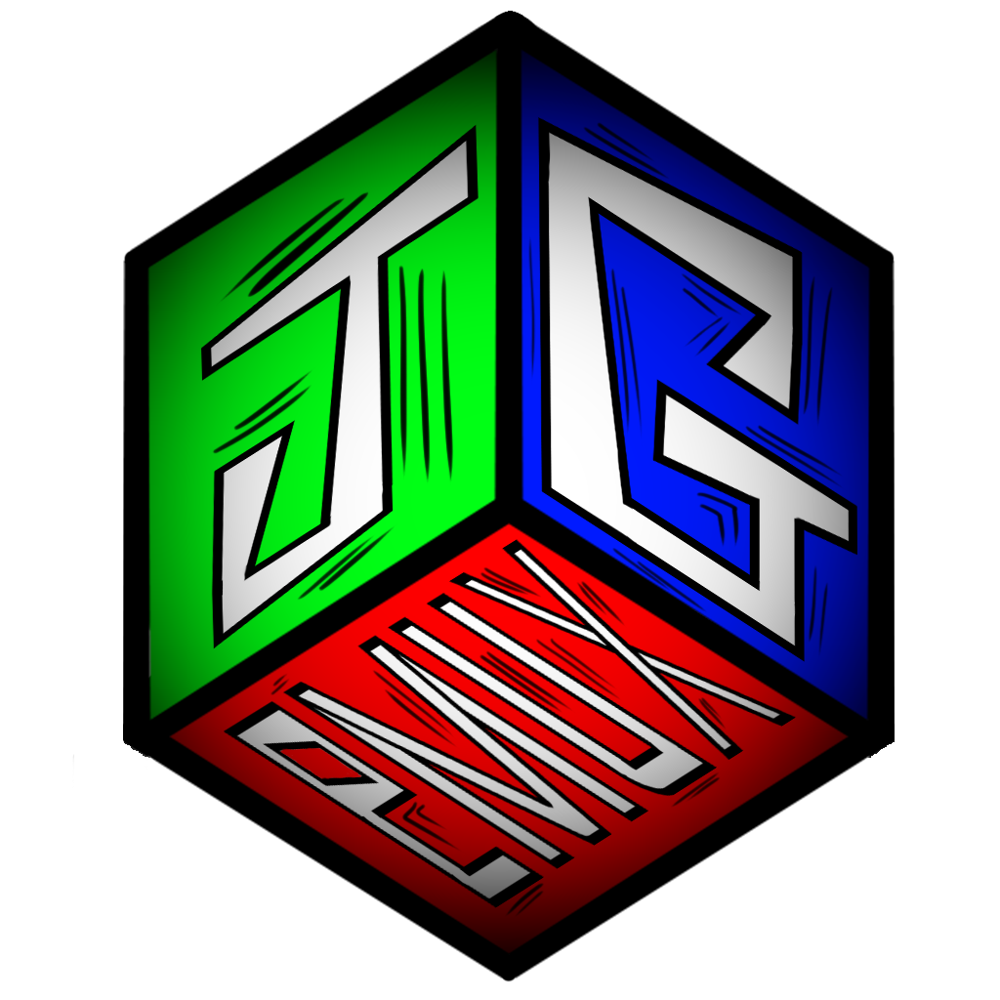

[](https://github.com/ViiSE/jemuxg/actions/workflows/build.yml)



# jemuxg

Эмулятор старых консолей. Реализованы NES, Atari 2600 и Sega SG-1000.
Для SG-1000 поддерживаются NTSC-картриджи `.sg`/`.sc`; запуск проверен
на Bomb Jack, H.E.R.O., Flicky, Girl's Garden, Monaco GP, Zaxxon, Q-bert
и Hustle Chumy.

## Сборка

Нужен JDK 25.

```bash
JAVA_HOME=/path/to/temurin-25 mvn clean package
```

## Запуск

Без аргументов открывается окно выбора ROM:

```bash
java -cp target/classes ru.viise.jemuxg.app.Main
```

Можно передать ROM сразу. Консоль определяется по расширению:
`.nes` → NES, `.a26` → Atari 2600, `.sg`/`.sc` → Sega SG-1000.

```bash
java -cp target/classes ru.viise.jemuxg.app.Main game.nes
java -cp target/classes ru.viise.jemuxg.app.Main game.a26
java -cp target/classes ru.viise.jemuxg.app.Main game.sg
# или
java -cp target/classes ru.viise.jemuxg.app.Main --rom game.nes
```

Локальную коллекцию удобно держать в `roms/nes`, `roms/atari2600` и
`roms/sg1000` — папка `roms/` исключена из git, чтобы не коммитить ROM.
Например:

```bash
java -cp target/classes ru.viise.jemuxg.app.Main "roms/sg1000/Bomb Jack (Japan).sg"
```

Для неоднозначных файлов консоль можно указать явно:

```bash
java -cp target/classes ru.viise.jemuxg.app.Main --console atari2600 game.bin
java -cp target/classes ru.viise.jemuxg.app.Main --console sg1000 game.bin
```

Схему картриджа Atari 2600 можно задать явно:

```bash
java -cp target/classes ru.viise.jemuxg.app.Main game.a26 --mapper e0
```

Поддерживаются `auto` (по умолчанию), `2k`, `4k`, `f8`, `f6`, `f4`,
`f8sc`, `f6sc`, `f4sc`, `3f`, `3e`, `e0`, `e7`, `fe`, `dpc`. Автоопределение
идёт по размеру: 2K/4K — фиксированные, 8K — F8, 10K/10495 — DPC, 12K — E7, 16K — F6,
32K — F4. Для 8K имя файла может подсказать `e0`, `fe` или `f8sc`;
16K — `e7`/`f6sc`; 32K — `f4sc`. Схемы 3F/3E неоднозначны и задаются
только явно.

Проверка без окна (headless):

```bash
java -Djava.awt.headless=true -cp target/classes ru.viise.jemuxg.app.Main --smoke
```

## Управление

| Клавиша | Кнопка |
| --- | --- |
| Стрелки | Крестовина / джойстик / paddle |
| Z / A / Space | A (на Atari 2600 — fire) |
| X / S | B |
| Enter | Start |
| Shift / Backspace | Select |
| Мышь / трекпад | Atari 2600: paddle; ЛКМ — fire и перетаскивание paddle |
| F2 | Atari 2600 и SG-1000: Reset |
| F3 | Atari 2600: Select |
| F4 | Atari 2600: Color/B&W |
| F10 | Пауза / режим шага по кадрам |
| Стрелки ↑ / ↓ | В режиме паузы: следующий / предыдущий кадр |
| F12 | Отладочный снимок текущего кадра |

Звук выводится через `javax.sound.sampled`; при отсутствии аудиоустройства
эмулятор продолжает работать без звука.

Окно открывается в трёхкратном размере кадра консоли: NES — 768×720,
Atari 2600 — 480×576, Sega SG-1000 — 768×576. При изменении размера окна
картинка масштабируется с сохранением пропорций.

## Тесты

Контрактные тесты и тестовые ROM запускаются на фазе `test`:

```bash
JAVA_HOME=/path/to/temurin-25 mvn test
```

`mvn package` также прогоняет их перед сборкой jar. При необходимости весь
набор можно запустить вручную:

```bash
JAVA_HOME=/path/to/temurin-25 mvn -q -B test-compile
java -cp target/classes:target/test-classes \
  ru.viise.jemuxg.console.nes.AllTests
```

Набор включает:

- PPU: рендеринг, mirroring, NMI, sprite 0 hit, save/restore.
- APU: каналы, frame counter, IRQ, DC removal, save/restore.
- Мапперы: NROM, MMC1, CNROM, MMC3, PRG/CHR banking, PRG RAM, IRQ.
- Ввод: `$4016/$4017`, strobe, два порта, сброс.
- nestest: полный golden-log на 8991 инструкцию.
- Blargg PPU и sprite-hit ROM: проверка `framebuffer.idx` по эталонному
  SHA-256. ROM лежат в `src/test/resources/test-roms/`.
- Atari 2600: 6507, карта памяти, RIOT, TIA (видео, звук, коллизии,
  ввод), мапперы, save/restore и интеграция машины.
- Atari reference ROM: сравнение кадров `colors` и `score-mode` из
  missingno-vcs-tests с эталонными PNG Stella. Эталоны лежат в
  `src/test/resources/test-roms/atari/`.
- SG-1000: каркас, карта памяти и картриджи, Z80, TMS9918A (Graphics
  I/II, Multicolor, Text, спрайты, IRQ, save/restore), SN76489
  (три тона, шум, громкость, save/restore), ввод P1/P2/Reset,
  save/restore машины, отладочные снимки, синтетический интеграционный
  тест и опциональный smoke реальных ROM.
- Z80: набор команд, флаги, такты, прерывания, все префиксы и
  опциональный харнесс для zexdoc/zexall.

## Atari 2600

Реализована NTSC-модель: 160×192 видимых пикселя, 262 строки по 228
цветовых тактов, CPU 6507 на 1,19 МГц. TIA — цикл-точный порт модели
Stella: задержки регистров, playfield/player/missile/ball, VDEL, HMOVE
с comb-эффектом, коллизии, WSYNC и аналоговые paddle-входы.
Поддерживаются картриджи 2K/4K, F8/F6/F4, 3F, 3E, E0, E7, FE, DPC
(Pitfall II) и SuperChip, а также автоопределение схемы по размеру и
имени файла. Схему можно задать через `--mapper`.

Ограничения текущей реализации:

- нет PAL/SECAM и переключения частоты кадров;
- CPU 6507 не является полностью цикл-точным на уровне отдельных тактов;
- save/restore доступен через API `Stateful`, но в UI пока нет хоткея
  сохранения/загрузки.

## Sega SG-1000

Каркас консоли: провайдер `sg1000`, слот картриджа 8–48 КБ, видео
256×192 и звуковой выход 44,1 кГц. Ядро Z80 готово: документированные
команды, префиксы CB/ED/DD/FD/DDCB/FDCB, флаги, такты, прерывания и
тесты всех групп команд. Z80 подключён к карте памяти: ROM
`$0000–$BFFF`, RAM 1 КБ в `$C000–$C3FF` с зеркалами до `$FFFF`,
картриджи 8–48 КБ кратно 8 КБ (включая 40 КБ) и Sega My Card.

Видеоядро TMS9918A готово: 16 КБ VRAM, порты `$BE/$BF` с зеркалами,
режимы Graphics I/II, Multicolor и Text, 32 спрайта с увеличением,
early clock, флагом 5-го спрайта и коллизиями, VBlank IRQ и палитра
TMS9918. Машина выполняет по 228 тактов CPU на строку и отдаёт кадр
256×192. Звук — SN76489AN: три тональных канала, шум, 15-битный LFSR,
нелинейная громкость и микширование в 44,1 кГц. Ввод готов: джойстики
P1/P2 через `$DC/$DD` с зеркалами, активный низкий уровень и Reset через
F2. Машина поддерживает полный save/restore (Z80, RAM, VDP, PSG, позиция
внутри кадра, счётчики и картридж), поэтому F10/↑/↓ работают и для SG-1000.
F12 сохраняет отладочный снимок с Z80/VDP/PSG, RAM, VRAM и framebuffer в
`debug/<rom>/frame-N/`. Запуск проверен на Bomb Jack, H.E.R.O., Flicky,
Girl's Garden, Monaco GP, Zaxxon, Q-bert и Hustle Chumy; другие игры
требуют ROM. Подробный план — `todos/TODO-SG-1000.md`.

Ограничения SG-1000:

- только NTSC, без PAL/SECAM;
- нет SC-3000 (клавиатура, BASIC), кассет и расширений RAM;
- тайминги доступа к VRAM 8/2 мкс не блокируют CPU;
- save/restore проверяет картридж по размеру и имени, не по хэшу;
- эталонные скриншоты автоматизированы только для синтетического ROM и
  smoke-тестов семи игр.

## Отладка

F10 включает режим паузы. В нём стрелка вверх выполняет один кадр вперёд,
стрелка вниз — один кадр назад (если консоль поддерживает сохранение полного
состояния). F12 сохраняет снимок текущего кадра в каталог `debug/` рядом с
рабочим каталогом запуска. Для машин с полным состоянием дополнительно
записывается `machine-state.bin`.

Снимок кадра:

```text
debug/<имя-ROM>/frame-<номер>/
├── screenshot.png      # скриншот 256×240
├── framebuffer.argb    # ARGB, 4 байта на пиксель, little-endian
├── framebuffer.idx     # индекс палитры NES (0..63), 1 байт на пиксель
├── cpu-ram.bin
├── prg-ram.bin
├── vram.bin
├── palette.bin
├── oam.bin
├── registers.txt       # PC, A, X, Y, SP, P
├── hashes.txt          # SHA-256 для бинарных файлов
└── meta.json           # ROM, кадр, размеры, маппер, формат буферов
```

`framebuffer.idx` удобно сравнивать с эталонным эмулятором: он не зависит
от RGB-палитры и различий в цветовых каналах.

Для Atari 2600 снимок содержит:

```text
debug/<имя-ROM>/frame-<номер>/
├── screenshot.png      # скриншот 160×192
├── framebuffer.argb    # ARGB, 4 байта на пиксель, little-endian
├── framebuffer.idx     # индекс палитры TIA (0..127), 1 байт на пиксель
├── riot-ram.bin        # 128 байт RAM RIOT
├── tia-registers.bin   # 64 регистра TIA (защёлки и текущие позиции)
├── riot-registers.bin  # 32 регистра RIOT
├── mapper-ram.bin      # RAM маппера (пустой для схем без RAM)
├── registers.txt       # CPU, TIA, RIOT, маппер
├── hashes.txt          # SHA-256 для бинарных файлов
└── meta.json           # ROM, кадр, размеры, маппер
```

## nestest

Для проверки CPU можно запустить диагностический ROM nestest и сравнить его
с эталонным логом:

```bash
java -cp target/jemuxg-1.0-SNAPSHOT.jar \
  ru.viise.jemuxg.console.nes.debug.NestestRunner \
  nestest.nes nestest.log
```

Runner стартует с `PC=$C000`, `SP=$FD`, `P=$24`, выполняет по одной инструкции
и сравнивает `PC/A/X/Y/P/SP`, байты опкодов и накопленные циклы.

Чтобы сохранить фактический лог:

```bash
java -cp target/jemuxg-1.0-SNAPSHOT.jar \
  ru.viise.jemuxg.console.nes.debug.NestestRunner \
  nestest.nes nestest.log --write-log nestest.actual.log
```

Формат фактического лога:

```text
# jemuxg nestest CPU log: PC, opcode bytes, A, X, Y, P, SP, cumulative CYC
C000  4C F5 C5  A:00 X:00 Y:00 P:24 SP:FD CYC:7
C5F5  A2 00     A:00 X:00 Y:00 P:24 SP:FD CYC:10
```

При первом расхождении runner печатает номер строки и что ожидалось/получилось,
завершается с кодом 1, а `--write-log` сохраняет пре-состояние проблемной
инструкции. Nestest проверяет только CPU, не PPU, APU или мапперы.

### Авторы:
- @viise
- @knbik

## Благодарности

TIA Atari 2600 в jemuxg портирована из проекта
[Stella](https://github.com/stella-emu/stella) — открытого эмулятора
Atari 2600. За основу взяты `TIA.cxx`, `Player.hxx/.cxx`,
`Missile.hxx/.cxx`, `Ball.hxx/.cxx`, `Playfield.hxx/.cxx` и палитра NTSC
из `PaletteHandler.cxx`.

Особая благодарность авторам и участникам проекта Stella за их
многолетнюю работу, документацию и точную эмуляцию оборудования Atari 2600.
